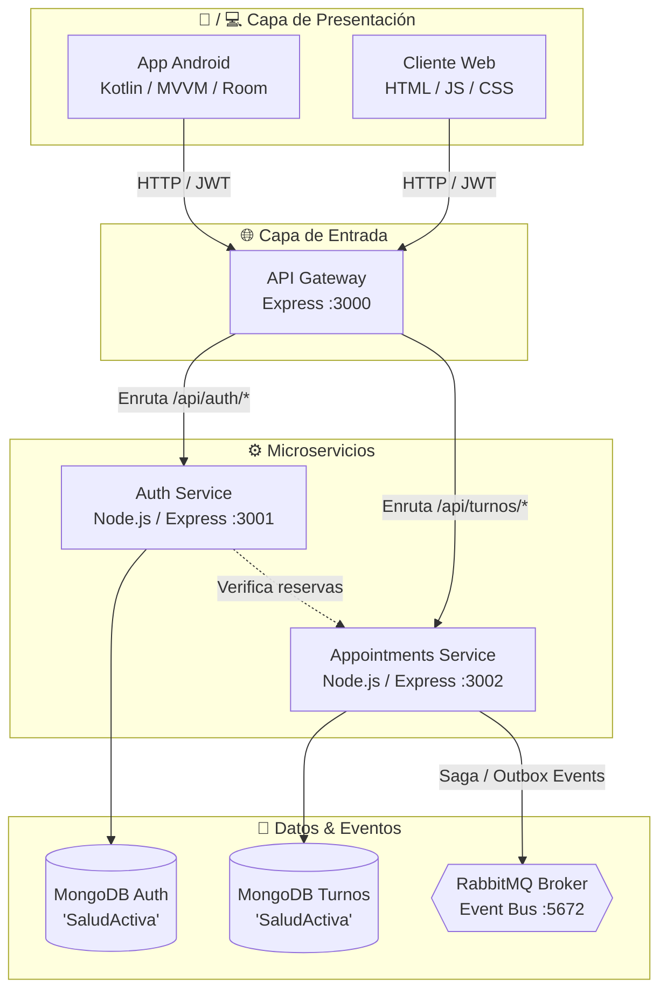

# Salud Activa · Gestión de Bienestar Médico

> **Demo del Corte 3 de Sistemas Distribuidos (CORHUILA):** Evolución de una plataforma monolítica hacia una arquitectura de microservicios contenerizada con API Gateway, patrón **Saga** con compensación, **Outbox**, eventos distribuidos vía RabbitMQ y pipeline de CI/CD automatizado.

---

## 📌 Arquitectura del Sistema

El ecosistema **Salud Activa** desacopla la lógica de autenticación y gestión de turnos médicos en microservicios independientes que ejecutan en contenedores isolados detrás de un **API Gateway**, cada uno siendo dueño de su base de datos lógica MongoDB (Anexo J).



---

## 🚀 Correrlo (Guía de Ejecución Rápida)

| Entorno / Modo | Comandos | Dirección / Acceso |
| :--- | :--- | :--- |
| **Docker Compose (Recomendado)** | `Copy-Item .env.example .env`<br/>`docker compose up --build -d` | API Gateway: `http://localhost:3000`<br/>Auth: `http://localhost:3001`<br/>Turnos: `http://localhost:3002` |
| **Backend Local (Node.js)** | `cd backend`<br/>`npm ci`<br/>`npm start` | `http://localhost:3000` |
| **Pruebas Automatizadas** | `cd backend`<br/>`npm test` | 25 pruebas unitarias, de contrato y Saga pasando al 100% |
| **App Android (`/app`)** | Abrir proyecto en Android Studio → Sync Gradle → Run | Conecta por defecto a `http://10.0.2.2:3000` (Emulador) o Backend Público |

> **Nota para Docker:** Para apagar los servicios manteniendo los datos, ejecuta `docker compose down`. Para reiniciar limpiando los volúmenes, ejecuta `docker compose down -v`.

---

## 🔌 API Gateway & Endpoints

Todos los endpoints principales están expuestos y consolidados a través del API Gateway en el puerto `3000`:

| Método y Ruta | Descripción | Respuestas HTTP |
| :--- | :--- | :--- |
| `GET /health/live` | Estado de liveness (supervivencia del contenedor) | `200` |
| `GET /health/ready` | Estado de readiness (verifica MongoDB, RabbitMQ y contratos) | `200` · `503` |
| `POST /api/auth/register` | Registro de nuevos usuarios/pacientes | `201` · `400` · `409` |
| `POST /api/auth/login` | Autenticación y generación de token JWT | `200` · `401` |
| `GET /api/turnos` | Obtención de catálogo de turnos médicos disponibles | `200` · `500` |
| `POST /api/turnos` | Reserva de turno mediante **Saga de Reserva** | `201` · `400` · `409` · `500` |
| `POST /api/demo/fail-next-saga` | Inyección de fallo para demostración de compensación de Saga | `200` |

---

## ⚙️ Variables de Entorno (`.env`)

Copia el archivo [.env.example](file:///C:/Users/andyb/AndroidStudioProjects/GestionTurnosApp/.env.example) a `.env` en la raíz del proyecto para ajustar la configuración:

| Variable | Descripción | Valor por Defecto Local |
| :--- | :--- | :--- |
| `BACKEND_PORT` | Puerto expuesto por el API Gateway | `3000` |
| `MONGODB_URI` | Cadena de conexión a MongoDB | `mongodb://localhost:27017/SaludActiva` |
| `RABBITMQ_URL` | URL de conexión al broker RabbitMQ | `amqp://localhost:5672` |
| `JWT_SECRET` | Clave secreta para firma y verificación de tokens JWT | `local-development-jwt-secret-change-before-deploy` |
| `SERVICE_TOKEN` | Token interno para comunicación inter-servicios | `local-development-service-token` |
| `DEMO_FAILURE_ENABLED` | Habilita la inyección de fallos para demos de Saga | `true` |

---

## 🔁 Arquitectura de Resiliencia: Saga & Outbox

La reserva de turnos coordina el estado entre `appointments-service` y `auth-service` utilizando un patrón de **Saga Orquestada** combinado con un **Transactional Outbox**:

1. **Reserva Idempotente:** Al solicitar un turno (`POST /api/turnos`), `appointments-service` crea la reserva previa y encola el evento en el Outbox.
2. **Publicación y Consumo:** El worker transaccional lee del Outbox y publica el evento en RabbitMQ.
3. **Inyección de Fallo y Compensación:** Se puede probar la resiliencia ejecutando `POST /api/demo/fail-next-saga`. Al fallar el paso posterior, la saga ejecuta la **acción compensatoria** cancelando el turno y liberando la reserva del usuario automáticamente.

---

## 🔄 Pipeline de Integración y Despliegue Continuo (CI/CD)

Ubicación del workflow: [.github/workflows/ci-cd.yml](file:///C:/Users/andyb/AndroidStudioProjects/GestionTurnosApp/.github/workflows/ci-cd.yml)

```text
[ Push / PR a main ] 
       ↓
 1. Run Tests (npm test - 25/25 passing)
       ↓
 2. Validate Compose Stack (docker compose config)
       ↓
 3. Security Scan (Trivy vulnerability check)
       ↓
 4. Build & Push Images to GHCR
       ↓
 5. Validate Healthchecks (/health/ready)
```

---

## 📚 Documentación de Arquitectura

Toda la documentación técnica, diagramas C4, ADRs y modelos de datos se encuentran organizados en [docs/arquitectura/README.md](file:///C:/Users/andyb/AndroidStudioProjects/GestionTurnosApp/docs/arquitectura/README.md):

- [Modelos C4 de Contexto y Contenedores](file:///C:/Users/andyb/AndroidStudioProjects/GestionTurnosApp/docs/05-architecture/overview.md)
- [Registros de Decisiones de Arquitectura (ADRs)](file:///C:/Users/andyb/AndroidStudioProjects/GestionTurnosApp/certification/README.md)
- [Modelado de Amenazas STRIDE](file:///C:/Users/andyb/AndroidStudioProjects/GestionTurnosApp/docs/05-architecture/security/stride-BrayanYara1.md)
- [Modelos de Datos y Entidades](file:///C:/Users/andyb/AndroidStudioProjects/GestionTurnosApp/DATA_MODELS_MASTER.md)
- [Infraestructura en AWS Terraform](file:///C:/Users/andyb/AndroidStudioProjects/GestionTurnosApp/terraform_aws/README.md)
