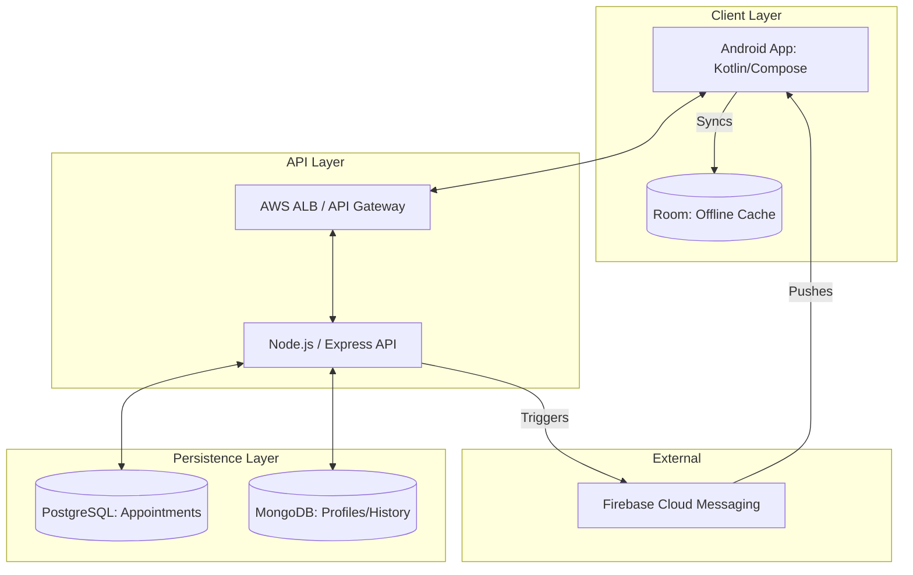

# ADR-002: Technological Stack Selection for MVP (Corte 1)

*   **Status:** Accepted
*   **Date:** 2026-09-03
*   **Authors:** GestionTurnosApp Development Team

---

## 1. Context
To establish the technical foundations for the **Salud Activa (GestionTurnosApp)** MVP, we need to select a stack that balances performance, development speed, and scalability. The project requires high availability, offline support for patients, and a highly flexible profile system.

## 2. Research and Comparisons

### 2.1. Frontend (Mobile App)
| Alternative | Framework/Language | Pros | Cons |
| :--- | :--- | :--- | :--- |
| **Option A (Chosen)** | **Native Android (Kotlin + Compose)** | Best performance, deep access to hardware (Biometrics), official support. | Longer learning curve for non-Android devs. |
| **Option B** | **React Native** | High code reuse with web, faster initial development for simple UIs. | Performance overhead, bridge-related bugs, harder offline logic. |

### 2.2. Backend (API)
| Alternative | Framework/Language | Pros | Cons |
| :--- | :--- | :--- | :--- |
| **Option A (Chosen)** | **Node.js (Express/TypeScript)** | High throughput (Event-loop), JSON-native, huge ecosystem, fast prototyping. | Single-threaded for heavy CPU tasks. |
| **Option B** | **Java (Spring Boot)** | Strong typing, enterprise-grade security, excellent for complex transactions. | Verbose, slower startup (cold starts on Fargate), higher RAM usage. |

### 2.3. Database (Persistence)
| Alternative | Type | Justification |
| :--- | :--- | :--- |
| **PostgreSQL (Chosen)** | Relational (SQL) | Used for **Appointments**. Guarantees ACID consistency for scheduling and prevents double-booking via constraints. |
| **MongoDB (Chosen)** | Document (NoSQL) | Used for **User Profiles & Medical Records**. Allows flexible schemas for varying medical history data and high scalability. |

---

## 3. Final Decision: The "Salud Activa" Stack

Based on the requirements, the following stack is defined:

-   **Frontend:** Kotlin Native + Jetpack Compose + MVVM + Room (Offline cache) + Hilt (DI).
-   **Backend:** Node.js + Express.js + JWT (Security).
-   **Databases:** Polyglot Persistence (PostgreSQL for Turnos / MongoDB for Profiles).
-   **Infrastructure:** AWS (ECS Fargate, RDS, DocumentDB) + Terraform (IaC).
-   **Tools:** Git (Conventional Commits), GitHub Actions (CI/CD), Postman (API testing).

## 4. Technical Justification

1.  **Kotlin/Compose:** Ensures a high-quality UI/UX with smooth transitions and robust offline support via Room, critical for medical contexts.
2.  **Node.js:** Aligns with the "API-first" principle and allows for rapid iteration of the medical domain logic.
3.  **Polyglot Persistence:** We don't force a single DB type. We use the right tool for the job: Relations for appointments and Documents for medical flexibility.
4.  **AWS Fargate:** Reduces operational overhead by using serverless containers, allowing the team to focus on code rather than server maintenance.

## 5. Technology Architecture Diagram

## 6. Consequences
-   **Positive:** Highly decoupled architecture, specialized storage for business logic, and enterprise-grade scalability.
-   **Negative:** Increased complexity in managing two database engines (SQL and NoSQL).
